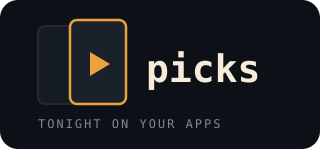
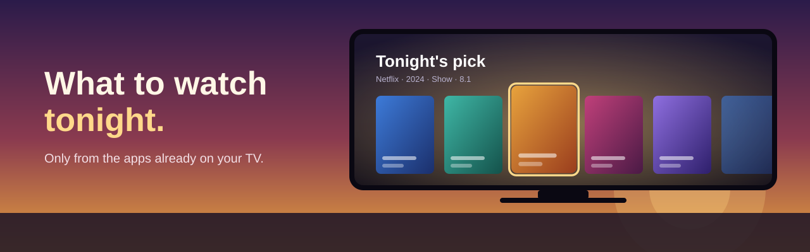
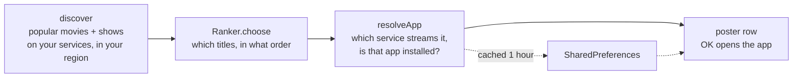

<div align="center">
  
  <h1>picks</h1>
  <p><strong>An Android TV add-on that shows what to watch tonight, only from the streaming apps already on your TV.</strong></p>
  <p>Posters · Backdrops · Opens the right app · One 16 KB APK · No libraries</p>
  <p>
    <a href="LICENSE"></a>
    
    
    
    
    
  </p>
  <p>
    <a href="#features">Features</a> ·
    <a href="#install">Install</a> ·
    <a href="#how-it-works">How it works</a> ·
    <a href="#what-you-get">What you get</a> ·
    <a href="#risks-and-limits">Risks and limits</a> ·
    <a href="#development">Development</a>
  </p>
</div>



Every streaming app has its own home screen, and none of them know what the others have. Picks asks
[TMDB](https://www.themoviedb.org) what is popular on the services you use in your country, throws away anything
whose app isn't installed on this TV, and shows the rest as a shelf of posters. Press OK on one and the app that
streams it opens.

It is built as an add-on for the [Clean Your TV](https://github.com/Gathin23/cleanyourtv) launcher: it declares a
*module card*, so after you answer **Show card** once it sits in your dock as **Picks**. On any other launcher it is
an ordinary Android TV app.

## Features

<table>
  <tr>
    <td width="33%"><strong>Only what you can watch</strong><br /><br />Each title is checked against TMDB's "where to stream" data for your region <em>and</em> against the apps installed on the TV, so nothing is on the page that you can't open.</td>
    <td width="33%"><strong>Real posters</strong><br /><br />A poster row with the focused title's backdrop, name, service, year, rating and overview behind it. Focus grows the poster; the d-pad is all you need.</td>
    <td width="33%"><strong>Tiny and light</strong><br /><br />Plain Java, no libraries, a 16 KB APK. A 12 MB image cache and a one-hour list cache keep it easy on a 1 GB TV.</td>
  </tr>
  <tr>
    <td><strong>Your taste in one function</strong><br /><br />Which titles make the page is decided in a single pure function, <code>Ranker.choose</code>: a list in, a list out, no network and no UI.</td>
    <td><strong>Launcher card</strong><br /><br />Declares a Clean Your TV <em>module card</em> with its own label, caption and glow colour. The launcher asks the owner once before showing it.</td>
    <td><strong>One permission</strong><br /><br /><code>INTERNET</code>, for TMDB. No accounts, no analytics, no background services.</td>
  </tr>
</table>

## Install

You build it yourself, because the app needs **your own** free TMDB token compiled in.

1. **Get a token.** Create an account at [themoviedb.org](https://www.themoviedb.org/signup), then
   [Settings → API](https://www.themoviedb.org/settings/api) and request a developer key. Copy the **API Read Access
   Token** (the long one).
2. **Add it to the project.**
   ```bash
   cp tmdb.properties.example tmdb.properties
   # edit tmdb.properties: tmdb_token=...   tmdb_region=IN
   ```
   `tmdb.properties` is git-ignored. Use your two-letter country code for `tmdb_region`.
3. **Build** with JDK 17, the Android SDK (platform 34) and Gradle 8.7 or newer:
   ```bash
   gradle assembleRelease          # or ./build.sh, which uses a locally cached Gradle 8.7
   ```
4. **Install over ADB.**
   ```bash
   adb connect <tv-ip>:5555
   adb install -r app/build/outputs/apk/release/app-release.apk
   adb shell am start -n com.royals.picks/.PicksActivity      # opens it straight away
   ```
5. **On Clean Your TV,** press Home and answer **Show card**. To put it in the dock, add `com.royals.picks` to
   `dock_apps` in your theme's `config.json`.

## How it works



| Step | What happens |
|---|---|
| **1. Discover** | Two TMDB `discover` calls (movies and shows), sorted by popularity, limited to the providers in `Tmdb.SERVICES` and your `tmdb_region`. |
| **2. Rank** | `Ranker.choose` picks which candidates go forward. This is the part meant to be rewritten to your taste. |
| **3. Resolve** | For each candidate, one `/watch/providers` call. A title is kept only if one of its streaming services is in `SERVICES` **and** that app can be launched on this TV. |
| **4. Cache** | The final list is stored for an hour, so reopening the page is instant and TMDB isn't hit every time. |
| **5. Show** | A horizontal row of posters; focus loads that title's backdrop. OK starts the service's app with its leanback launch intent. |

## What you get

```
picks/
├── app/src/main/java/com/royals/picks/
│   ├── Tmdb.java            TMDB client, the Title model, provider id → app package map
│   ├── Ranker.java          which titles make the page (the one function to make your own)
│   ├── Images.java          3-thread image loader with a 12 MB LRU cache
│   └── PicksActivity.java   the full-screen page: poster row, backdrop, details
├── app/src/main/res/xml/module_card.xml   the Clean Your TV card: "Picks", amber glow
├── tmdb.properties.example                 copy to tmdb.properties and add your token
├── build.sh                                builds with a cached Gradle 8.7
└── docs/                                   banner and logo
```

Streaming services are mapped in one place:

| TMDB provider id | Service | TV app package |
|---|---|---|
| 8 | Netflix | `com.netflix.ninja` |
| 119 | Prime Video | `com.amazon.amazonvideo.livingroom` |
| 2336 | JioHotstar | `in.startv.hotstar` |

Add a row to `Tmdb.SERVICES` (and a `<package>` line under `<queries>` in the manifest) to support another service.
Look up ids with `GET /3/watch/providers/movie?watch_region=<your region>`.

## Risks and limits

> [!WARNING]
> **Your TMDB token is compiled into the APK.** Anyone who gets the APK can extract it. Keep your build to yourself,
> never publish an APK, and use a token you can revoke from your TMDB settings. `*.apk` and `tmdb.properties` are in
> `.gitignore` for this reason.

- **The ranking is a placeholder.** Right now `Ranker.choose` sorts by TMDB popularity. Rewrite it to taste.
- **Provider ids are per region.** The three ids above were checked against TMDB for **India (`IN`)**. Netflix and
  Prime Video are the same elsewhere, but JioHotstar's id (2336) is India-only: confirm yours before relying on it.
- **Ratings are TMDB's, not IMDb's.** TMDB's `vote_average` is its own audience score.
- **Availability data can be wrong or stale.** It comes from TMDB's providers dataset; a title may have left a
  service, or not yet arrived.
- **Tested on one TV** (a Xiaomi Mi TV, Android 10, Clean Your TV launcher) and only over ADB. Other TVs and other
  launchers are untested.
- **Pressing OK launches the service's app, not the title's page.** Deep-linking to a specific title would need a
  per-service link scheme this project doesn't have.
- **Only the three listed services are supported.** Everything else, installed or not, is ignored.
- **A flaky connection shows less, not an error page.** One failing title is skipped; a failed fetch falls back to the
  last cached list when there is one.

## Where things live

| Path | What |
|---|---|
| `tmdb.properties` | your token and region, git-ignored, read at build time |
| the app's `shared_prefs/picks.xml` | the cached list and when it was fetched (private to the app) |

To clear the cache: `adb shell pm clear com.royals.picks`. To remove the app: `adb uninstall com.royals.picks`.

## Architecture

`Tmdb.candidates` → `Ranker.choose` → `Tmdb.resolveApp` (per title) → cache → `PicksActivity`.

- **Taste is isolated.** `Ranker.choose(candidates, count, nowMillis)` is pure: it takes a list and the current time
  and returns a list. You can change what the page feels like without touching the network or the screen, and test
  it on a laptop.
- **Filter late, display only what works.** Candidates are fetched broadly, then each is resolved against the TV's
  installed apps, so the page never offers something that can't open.
- **Plain Android.** `HttpURLConnection`, `org.json`, `LruCache` and `BitmapFactory`. No image library, no JSON
  library, no coroutines, because the target TVs have as little as 1 GB of RAM.

## Development

```bash
./build.sh                        # builds the release APK (needs tmdb.properties and JDK 17)
adb logcat -s TvHomeCards         # why Clean Your TV accepted or dropped the card
```

There are no automated tests yet. `Ranker.choose` is the natural first place to add them.

## License

MIT. See [LICENSE](LICENSE). Not affiliated with TMDB, Netflix, JioHotstar, Amazon, or Clean Your TV.

This product uses the TMDB API but is not endorsed or certified by TMDB.
